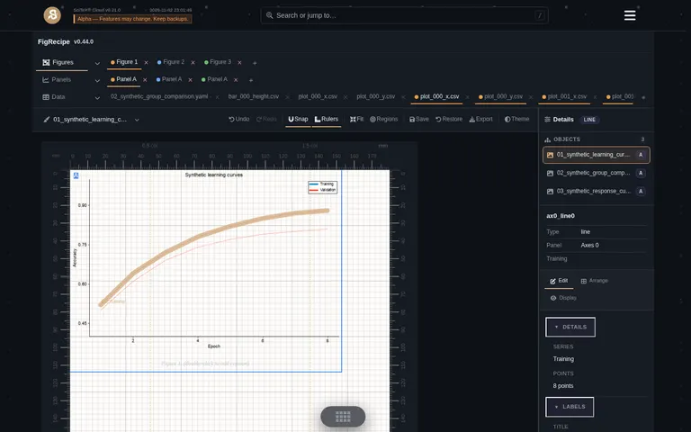
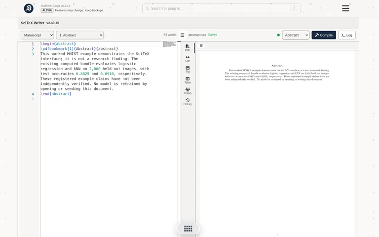
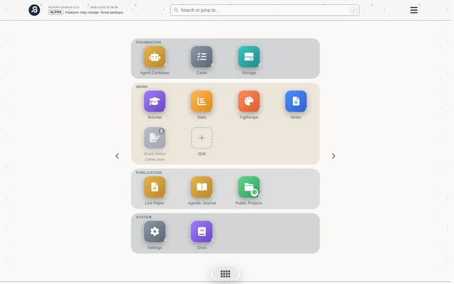
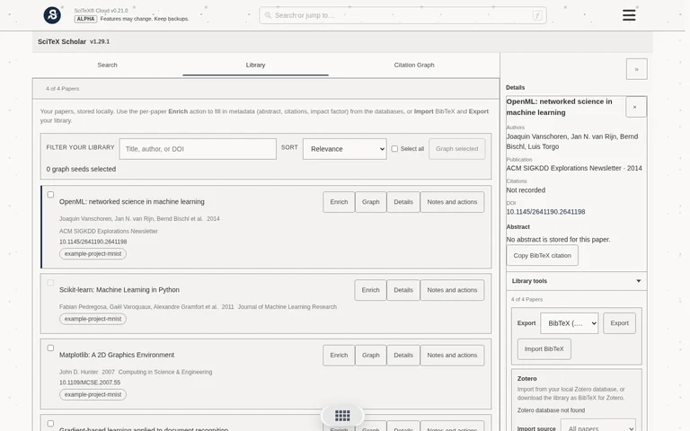
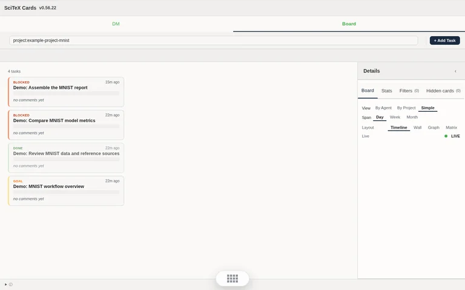

<p align="center">
  <a href="https://scitex.ai"></a>
</p>

# 科学研究のためのオープンソース・エコシステム

- **来歴に基づく検証** — [scitex-clew](https://github.com/scitex-ai/scitex-clew) による処理の記録と追跡。
- **決定論的な研究ツール** — 文献、データ、解析、図、論文執筆。
- **柔軟なインターフェイス** — Python API、CLI、MCP、スキル、Web API。

[SciTeX Cloud を開く](https://scitex.ai) · [ドキュメント](https://scitex.ai/apps/docs/) · [English](README.md) / **日本語**

> **SciTeX Cloud はアルファ版です。** 機能やデータ形式が変わる場合があります。バックアップを保管してください。

## SciTeX® Cloud のスクリーンショット

<p>
  <a href="assets/figrecipe-20261103-scene-768.webp"></a>
  <a href="assets/writer-20261102-768.webp"></a>
</p>

**FigRecipe** — 編集可能な図と再現可能なレシピ。**Writer** — LaTeX 編集と節ごとのプレビュー。
2026年11月2〜3日の開発画面です。合成データやデモの内容であり、研究成果ではありません。画像をクリックすると拡大できます。[画像の出典](assets/ASSET-MANIFEST.md)。

<details>
<summary>その他の画面：Hub・Scholar・Cards</summary>

### Hub

<a href="assets/hub-20261102-768.webp"></a>

### Scholar

<a href="assets/scholar-20261102-768.webp"></a>

### Cards

<a href="assets/cards-board-mnist-20261103-768.webp"></a>

ランチャー、選定した参考文献、合成データによるデモカードを示す開発画面です。Cards はアプリの挙動を示す作業例であり、検証済みの研究進捗ではありません。[各アプリのスクリーンショットを見る](https://scitex.ai/landing/#overview)。

</details>

## エコシステムの構成

| 層 | パッケージ |
|---|---|
| **プラットフォーム** | [scitex](https://github.com/scitex-ai/scitex-python) — Python ツールキット、[scitex-hub](https://github.com/scitex-ai/scitex-hub) — ブラウザ上の研究ワークスペース、[scitex-sdk](https://github.com/scitex-ai/scitex-sdk) — 単体アプリと Hub プラグインの開発 |
| **研究アプリ** | [Agent Container](https://github.com/scitex-ai/scitex-agent-container) · [Cards](https://github.com/scitex-ai/scitex-cards) · [Storage](https://github.com/scitex-ai/scitex-storage) · [Scholar](https://github.com/scitex-ai/scitex-scholar) · [Stats](https://github.com/scitex-ai/scitex-stats) · [FigRecipe](https://github.com/scitex-ai/figrecipe) · [Writer](https://github.com/scitex-ai/scitex-writer) · [Live Paper](https://github.com/scitex-ai/scitex-live-paper) · [Agentic Journal](https://github.com/scitex-ai/scitex-agentic-journal) |
| **共通基盤** | [scitex-clew](https://github.com/scitex-ai/scitex-clew) — 来歴の記録、[scitex-io](https://github.com/scitex-ai/scitex-io) — 科学データの入出力、[scitex-dev](https://github.com/scitex-ai/scitex-dev) — 検出・開発ツール・共通チェック |

各パッケージにドキュメントとライセンスがあります。[全リポジトリを見る](https://github.com/orgs/scitex-ai/repositories)。

## はじめる

```bash
uv venv .venv
source .venv/bin/activate
uv pip install scitex
scitex --help
```

Python ツールを単体で使うほか、[ホステッド版 Cloud](https://scitex.ai) や [セルフホストの手順](https://github.com/scitex-ai/scitex-hub)を利用できます。

[研究デモと出力を見る](https://github.com/scitex-ai/automated-research-demo) · [質問・アイデア](https://github.com/scitex-ai/scitex-python/discussions)

バグ報告や開発への参加は、該当パッケージの Issue と貢献ガイドをご覧ください。[貢献者ライセンス契約（CLA）](https://github.com/scitex-ai/scitex-python/blob/main/CLA.md)が適用されます。
