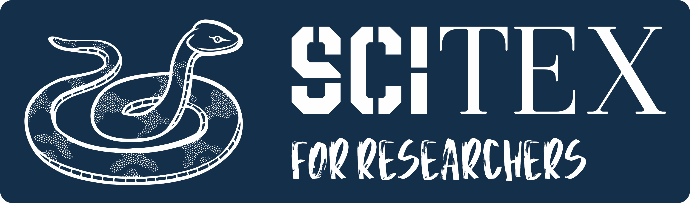
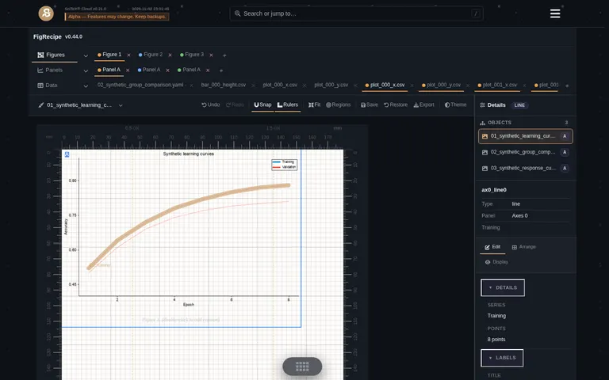
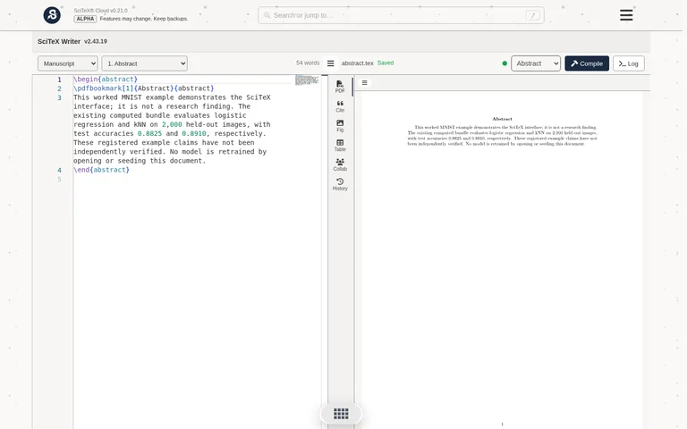
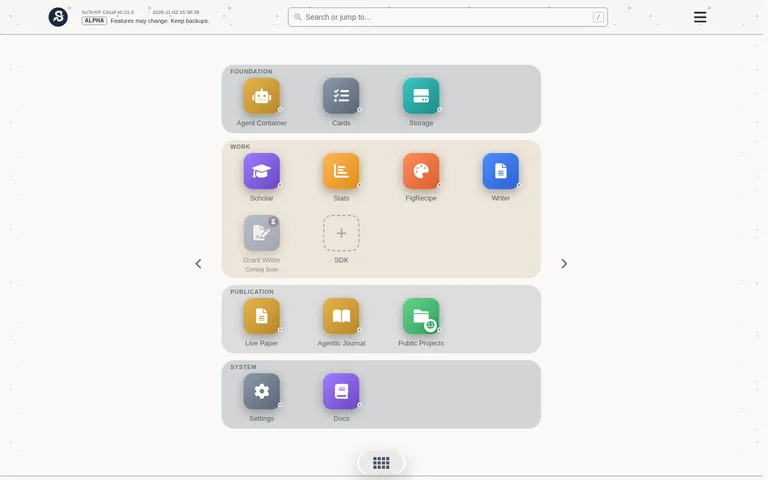
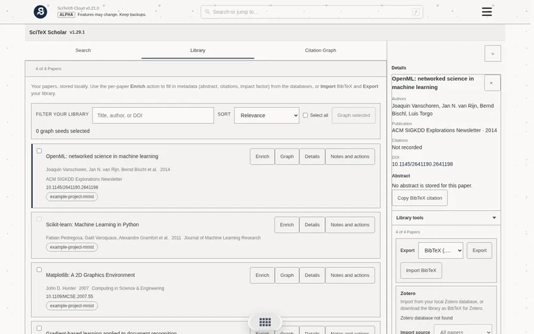
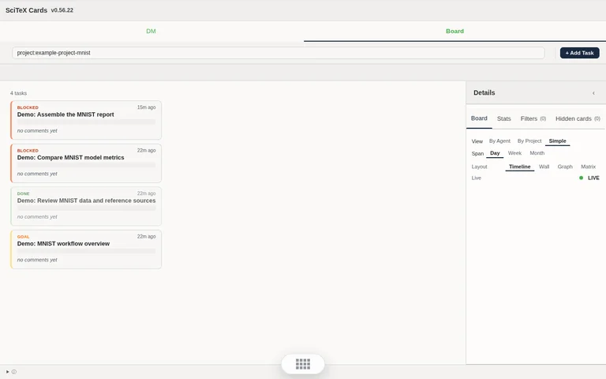

<p align="center">
  <a href="https://scitex.ai"></a>
</p>

# Open-source Ecosystem for Scientific Research

- **Provenance-based verification** with [scitex-clew](https://github.com/scitex-ai/scitex-clew).
- **Deterministic research tools** for literature, data, analysis, figures, and writing.
- **Flexible interfaces**: Python API, CLI, MCP, skills, and web API.

[Explore SciTeX Cloud](https://scitex.ai) · [Documentation](https://scitex.ai/apps/docs/) · **English** / [日本語](README.ja.md)

> **SciTeX Cloud is in alpha.** Features and data formats may change. Keep backups.

## Screenshots of SciTeX® Cloud

<p>
  <a href="assets/figrecipe-20261103-scene-768.webp"></a>
  <a href="assets/writer-20261102-768.webp"></a>
</p>

**FigRecipe** — editable figures and reproducible recipes. **Writer** — LaTeX editing and section previews.
Development captures from November 2–3, 2026; synthetic/demo content, not research findings. Click an image to enlarge. [Capture sources](assets/ASSET-MANIFEST.md).

<details>
<summary>More screenshots: Hub, Scholar, and Cards</summary>

### Hub

<a href="assets/hub-20261102-768.webp"></a>

### Scholar

<a href="assets/scholar-20261102-768.webp"></a>

### Cards

<a href="assets/cards-board-mnist-20261103-768.webp"></a>

Development captures of the launcher, curated references, and synthetic demo cards. The Cards examples illustrate app behavior rather than verified research progress. [Explore all app screenshots](https://scitex.ai/landing/#overview).

</details>

## The ecosystem

| Layer | Packages |
|---|---|
| **Platform** | [scitex](https://github.com/scitex-ai/scitex-python) — Python toolkit; [scitex-hub](https://github.com/scitex-ai/scitex-hub) — browser workspace; [scitex-sdk](https://github.com/scitex-ai/scitex-sdk) — standalone apps and Hub plugins |
| **Research apps** | [Agent Container](https://github.com/scitex-ai/scitex-agent-container) · [Cards](https://github.com/scitex-ai/scitex-cards) · [Storage](https://github.com/scitex-ai/scitex-storage) · [Scholar](https://github.com/scitex-ai/scitex-scholar) · [Stats](https://github.com/scitex-ai/scitex-stats) · [FigRecipe](https://github.com/scitex-ai/figrecipe) · [Writer](https://github.com/scitex-ai/scitex-writer) · [Live Paper](https://github.com/scitex-ai/scitex-live-paper) · [Agentic Journal](https://github.com/scitex-ai/scitex-agentic-journal) |
| **Shared foundation** | [scitex-clew](https://github.com/scitex-ai/scitex-clew) — provenance; [scitex-io](https://github.com/scitex-ai/scitex-io) — scientific I/O; [scitex-dev](https://github.com/scitex-ai/scitex-dev) — discovery, development tools, and shared checks |

Packages have their own documentation and licenses. [Browse all repositories](https://github.com/orgs/scitex-ai/repositories).

## Get started

```bash
uv venv .venv
source .venv/bin/activate
uv pip install scitex
scitex --help
```

Use the Python tools independently, explore the [hosted Cloud](https://scitex.ai), or follow the [self-hosting guide](https://github.com/scitex-ai/scitex-hub).

[Watch the research demo and inspect its outputs](https://github.com/scitex-ai/automated-research-demo) · [Questions and ideas](https://github.com/scitex-ai/scitex-python/discussions)

For bugs or contributions, use the relevant package's issue tracker and contribution guide. A [Contributor License Agreement](https://github.com/scitex-ai/scitex-python/blob/main/CLA.md) applies to contributions.
